# OctopusEAX

Voice effects for Discord and games on Windows. OctopusEAX puts your voice in a room, changes how it sounds, cleans up the noise around you and plays sounds into your mic.

- 15 echo rooms, from Bathroom to Haunted Cavern
- 42 voice masks, pitch, size and speed
- Noise isolation with 5 modes
- 7-band equalizer and a tone pad
- Sound clips, a 12-pad soundboard, and the sound of any program on the mic
- A recorder that keeps the last few minutes, and hotkeys that work inside games

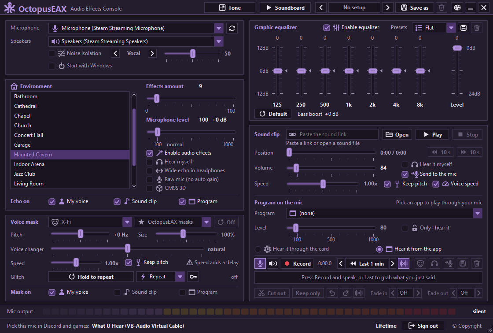

## What you need

- Windows 10 or 11, 64-bit
- A microphone
- VB-Audio Virtual Cable (free). OctopusEAX offers to set it up the first time you open it.

## Getting started

1. Open OctopusEAX. The first time, it asks for a key: copy your machine number, send it to us on [Discord](https://discord.gg/4xhsX9Cn7e), then paste the key you get back and press **Activate**.
2. Pick your microphone and your speakers or headphones at the top left.
3. In Discord or your game, choose the mic shown at the bottom of the window, **What U Hear (VB-Audio Virtual Cable)**, as your input device.
4. Pick a room and raise **Effects amount**. Tick **Hear myself** if you want to hear the result.

Rest the mouse on any control and a short hint tells you what it does.

## The main window

### Top bar

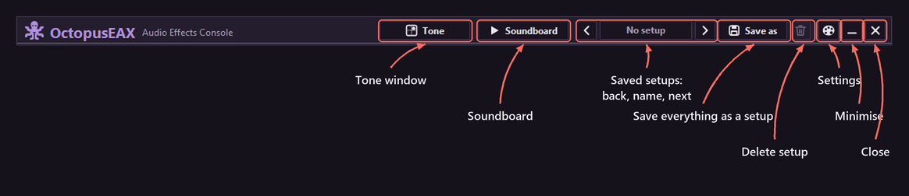

A setup keeps every setting on the main window. Save one with **Save as**, then switch between your setups with the arrows or with a hotkey.

### Microphone, speakers and noise isolation

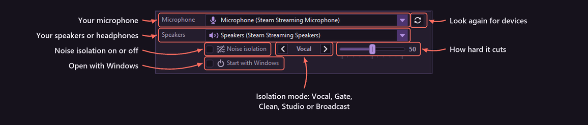

Noise isolation cuts room noise, keyboard clicks and other voices out of your mic.

- **Vocal** is a voice gate with its own low, mid and high lift. Its settings are in the Tone window.
- **Gate** only shuts the mic between words.
- **Clean**, **Studio** and **Broadcast** also clean up the sound.

Higher values cut more noise but can clip quiet words. For Vocal, 50 is the normal strength.

### Rooms

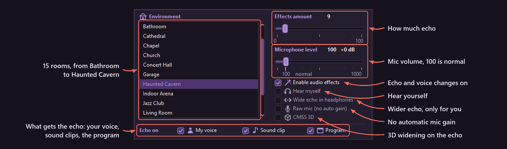

Pick a room from the list. **Effects amount** sets how much echo others hear: 0 turns it off, and above 50 the echo starts to cover your voice.

Under **Echo on**, choose what goes through the room: your voice, sound clips, the program's sound, or any mix of them.

If your voice keeps getting louder and quieter by itself, try **Raw mic**.

### Voice mask

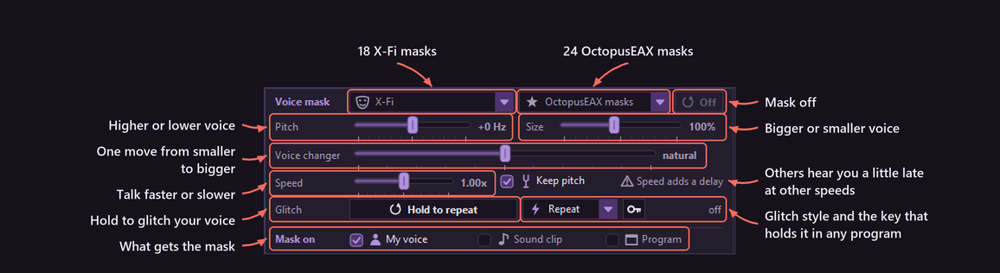

Pick a mask from either list, then fine-tune it with pitch, size, the voice changer and speed.

Hold **Hold to repeat** to glitch your voice. The list next to it picks the glitch style, and the key button sets a key that holds the glitch from any program.

### Equalizer

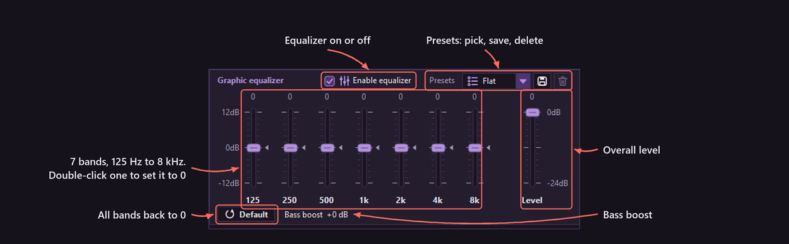

The equalizer shapes everything that goes to the mic. Drag a band up or down, and double-click it to put it back to 0. Save your own bands as a preset.

### Sound clip

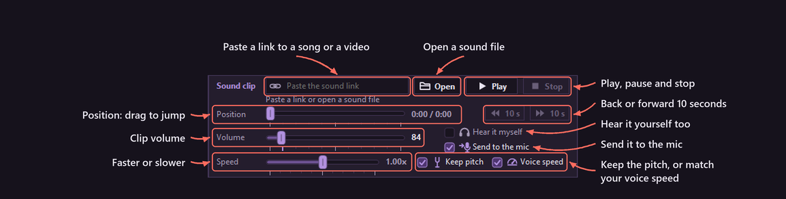

Paste a link or open a sound file, then press **Play**. Tick **Send to the mic** so others hear it, and **Hear it myself** to hear it too.

### Program on the mic

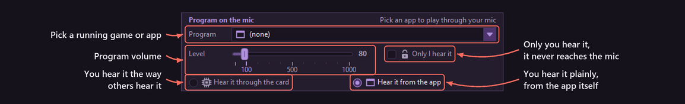

Pick a running game or app, and its sound goes into your mic. With **Only I hear it**, the sound stays in your headphones and never reaches the mic.

### Recorder

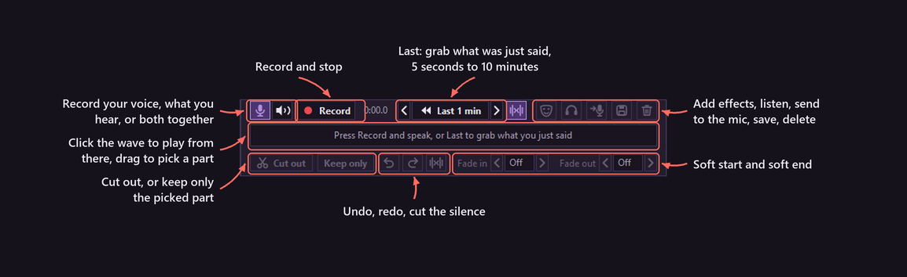

- **Record** records your voice with the effects, what you hear, or both at once.
- **Last** keeps the last part of what was said or played all the time, from 5 seconds up to 10 minutes, and puts it into the editor with one click.
- In the editor, click the wave to play from that point. Drag across it to pick a part, then cut it out or keep only that part.
- When you're done, send the recording to the mic, or save it as MP3, WAV, M4A, WMA or FLAC.

Ctrl+Z and Ctrl+Y undo and redo.

### Bottom bar

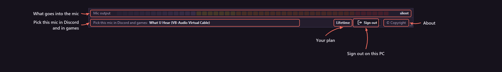

The meter shows what goes into the mic. Drag the corner of the window to make it bigger or smaller, and double-click the corner to go back to the normal size.

## Tone window

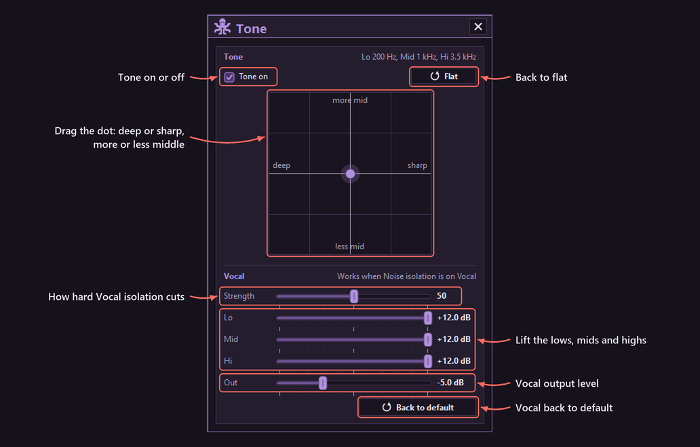

Move the dot to make your voice deeper or sharper, with more or less middle. The **Vocal** part sets the Vocal noise isolation: how hard it cuts, the low, mid and high lift, and its output level.

## Soundboard

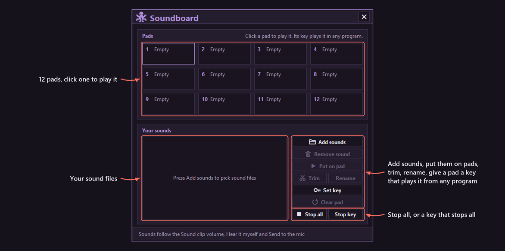

Add your sound files and put them on pads. Click a pad to play it, or give it a key that plays it from any program, even in a game. Pads follow the Sound clip volume, **Hear it myself** and **Send to the mic**.

## Settings

### Look

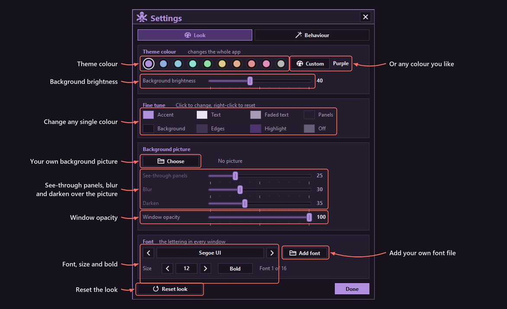

Change the colours, use your own background picture, make the window see-through, and pick the font.

### Behaviour and hotkeys

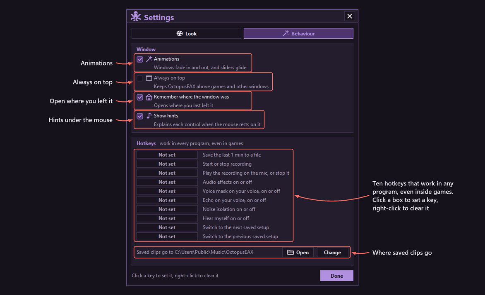

Hotkeys work in every program, even inside games. Click a key box and press the keys you want; right-click a box to clear it. Keys already used by the soundboard, the glitch or another program are refused.

## Building from source

1. Install Visual Studio 2026 with the **Desktop development with C++** workload.
2. Open `MasonEAX.sln`.
3. Choose **Release** and **x64**, then build.
4. The program is `build\MasonEAX\OctopusEAX.exe`.

| Folder | What is in it |
| --- | --- |
| `src/app.cpp`, `src/ui` | The window, the controls, fonts and the audio path |
| `src/reverb`, `src/presets` | The rooms |
| `src/voice` | Masks, pitch, speed and the glitch |
| `src/isolation` | Noise isolation |
| `src/equalizer` | The equalizer |
| `src/playback` | Sound clips, the soundboard, the recorder and program sound |
| `src/mixing`, `src/convolution`, `src/audio` | Levels, mixing and audio buffers |
| `src/cable` | VB-Audio Virtual Cable setup |
| `src/licensing` | The key check |
| `res` | The icon and the pictures |
